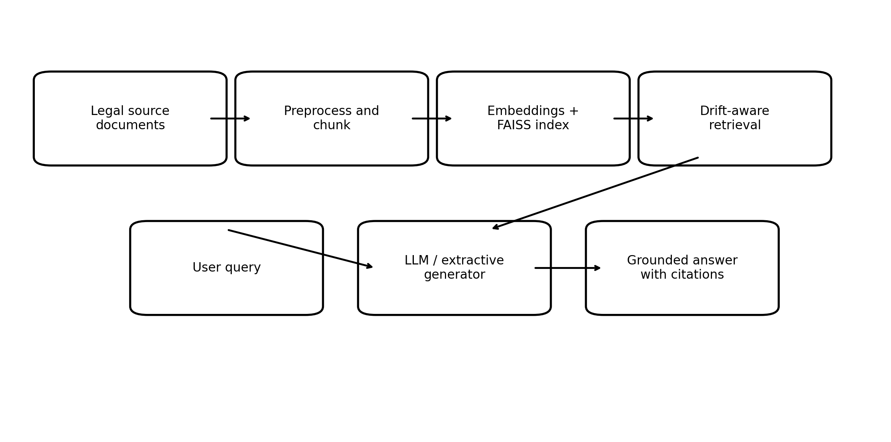

# Drift-Aware Legal RAG Chatbot for UK Law

My MSc Artificial Intelligence dissertation project (University of East London, 2026).

It is a retrieval-augmented generation (RAG) chatbot that answers questions over UK legal and regulatory text. The part I cared about most was not getting it to answer. It was getting it to be honest about when it should not be trusted. In law, a confident wrong answer is worse than no answer, so the system:

1. **Shows its sources.** Every answer comes with the retrieved passages and their similarity scores.
2. **Refuses to guess when retrieval is weak.** If the best match is below a confidence threshold, the language model is not called at all. The user gets the closest source extracts and a clear warning instead.
3. **Watches for drift.** Legal guidance changes. The system keeps a frozen baseline and measures whether the indexed documents, or the quality of retrieval for real queries, have moved away from it, using Population Stability Index (PSI) and KL divergence.

This is a prototype for decision support, not legal advice.



## How it works

```text
documents -> chunking -> embeddings -> FAISS index
                                          |
question -> embed -> top-k search -> confidence gate --(weak)--> source extracts + warning
                                          |
                                       (strong)
                                          v
                              LLM answer with [1] [2] citations
                                          |
              top-1 score logged -> rolling window -> PSI / KL vs baseline
```

| Step | Implementation |
| --- | --- |
| Chunking | Fixed-size character chunks with overlap (`CHUNK_SIZE`, `CHUNK_OVERLAP`) |
| Embeddings | `sentence-transformers/all-MiniLM-L6-v2`, with a TF-IDF fallback for machines that cannot download the model |
| Vector search | FAISS `IndexFlatIP` over L2-normalised vectors (inner product = cosine similarity). Falls back to NumPy if FAISS is not installed; a test checks both give the same ranking |
| Generation | OpenAI-compatible API, a local Ollama model, or an extractive mode that needs no LLM |
| Confidence gate | `MIN_CONFIDENCE` (default 0.35) on the top-1 cosine score |
| Drift | PSI and KL divergence against a baseline snapshot, with a minimum sample size before anything is reported |
| UI | Streamlit |

## Drift monitoring

Two different things can drift, so they are measured separately.

**Corpus drift** happens when the documents change, for example new guidance is published or legislation is amended. When the index is first built, a copy of the embeddings is saved as the baseline. Later builds keep that baseline (unless you pass `--reset-baseline`), so `scripts/check_drift.py` always compares against the same reference. Each chunk is reduced to its similarity to the baseline centroid, and PSI and KL are computed between the two distributions. The centroid shift is reported alongside as a number that is easy to interpret.

**Retrieval drift** happens when questions stop matching the documents well. A fixed set of reference queries (`data/reference_queries.txt`) is scored when the baseline is created. In the app, the top-1 score of each live query goes into a rolling window that is compared against those baseline scores.

PSI on three or four values is noise, not a signal. The app reports "insufficient data" until at least `MIN_DRIFT_WINDOW` queries (default 20) have been seen, and results on small samples are labelled as indicative.

PSI bands follow the usual convention: below 0.10 stable, 0.10 to 0.25 moderate, above 0.25 significant.

## Confidence gate

The threshold of 0.35 came from the reference queries. With sentence-transformer embeddings their top-1 scores sit roughly between 0.36 and 0.72, while off-topic questions score close to zero (for example, "Can my landlord keep my deposit?" scores about 0.06 because tenancy law is not in the corpus). So 0.35 lets in-domain questions through and stops the rest, although the lowest in-domain queries only just clear it. It is a starting point, not a tuned value: it depends on the embedding model and the corpus, and TF-IDF scores are on a different scale. Change it with `MIN_CONFIDENCE` in `.env`.

## Running it

```bash
python -m venv .venv
.venv\Scripts\activate          # Windows
source .venv/bin/activate       # macOS / Linux
pip install -r requirements.txt
cp .env.example .env            # then edit as needed

python scripts/build_index.py   # build the index and, on first run, the baseline
streamlit run app/streamlit_app.py
python scripts/check_drift.py   # exit code 0 stable/moderate, 1 significant, 2 no baseline
```

`LLM_PROVIDER` in `.env` chooses the generator: `extractive` (default, no API needed), `openai` (set `OPENAI_API_KEY`) or `ollama` (needs Ollama running locally).

## Tests

```bash
pytest -q
```

- `tests/test_drift.py`: PSI and KL behave correctly (zero for identical data, large for shifted data, values outside the baseline range are counted), corpus drift separates a resampled corpus from a real topic change, and the minimum-sample guard works.
- `tests/test_retrieval.py`: FAISS and NumPy return the same ranking and scores, scores are true cosine similarities, and the index saves, loads and rebuilds correctly.
- `tests/test_confidence_fallback.py`: a weak match never reaches the LLM and returns sourced extracts, a strong match does, and the threshold boundary behaves as expected.

The retrieval and pipeline tests use TF-IDF or stubs, so they run offline.

## Limitations

I want to be clear about what this does not show yet.

- **The corpus is a small sample, not real legal text.** `data/source_documents/` holds three short texts (about 500 characters each) written in the style of ICO guidance, FCA Consumer Duty guidance and UK legislation. They are enough to demonstrate the pipeline, the confidence gate and the drift checks, not to answer real legal questions.
- **Evaluation was qualitative.** I tested the system on a set of sample legal queries and checked the answers and sources by hand. There is no labelled test set yet, so there are no recall or precision figures.
- **Thresholds are not tuned.** The confidence threshold and PSI bands are reasonable defaults, not values fitted on data.

## Next steps

- Load real legislation from legislation.gov.uk (Open Government Licence) and recent ICO and FCA publications.
- Build a small labelled question set and measure recall@k and answer faithfulness.
- Tune `MIN_CONFIDENCE` on that set, and compare the gate against simply letting the LLM answer.
- Simulate a corpus update (old vs amended guidance) and show the drift check catching it.

## Project structure

```text
app/streamlit_app.py          Streamlit UI
scripts/build_index.py        Build the index and baseline
scripts/check_drift.py        Compare the current index with the baseline
scripts/run_app.py            Launch the app
src/legal_chatbot/
    config.py                 Settings from .env
    ingest.py                 Load and chunk documents
    retrieval.py              Embeddings and FAISS search
    generator.py              LLM providers, extractive and low-confidence answers
    pipeline.py               Retrieval, confidence gate and drift tracking
    drift.py                  PSI, KL divergence, corpus and retrieval drift
    prompts.py                System prompt
data/source_documents/        Sample corpus
data/reference_queries.txt    Fixed queries for the retrieval baseline
tests/                        pytest suite
```

## Author

Varun Srinath Amarnath, MSc Artificial Intelligence, University of East London.
